<h1 align="center">Mini Ship Interiors</h1>

<p align="center">
  <strong>Un Fleet Carrier en isométrique, multijoueur, jouable dans le navigateur.</strong><br>
  <sub>Par la communauté d'<a href="https://elitedangereuse.fr">elitedangereuse.fr</a>, pour les CMDR d'Elite Dangerous.</sub>
</p>

<p align="center">
  
  
  
  
  
</p>

<p align="center">
  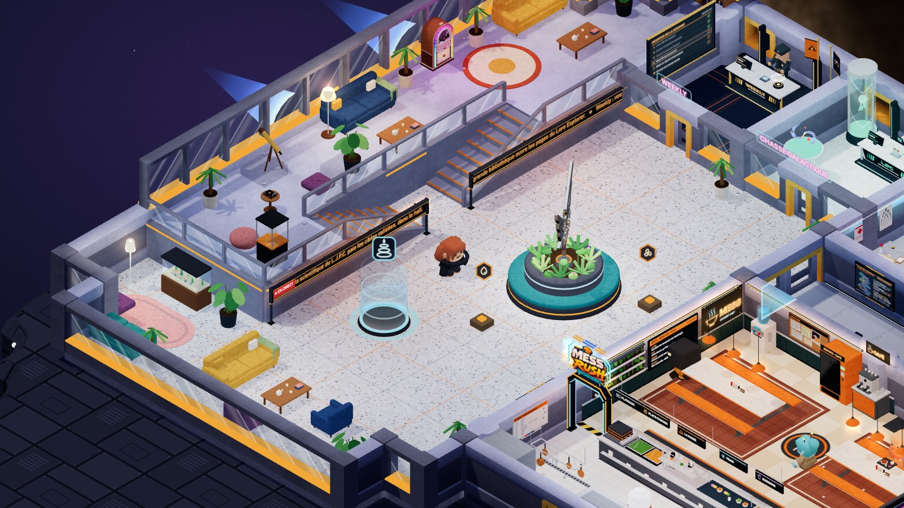
</p>

---

## Le principe

On embarque à bord d'un vaisseau de quatre ponts. On s'y promène, on croise les autres joueurs connectés, on discute, on s'installe, on joue. Un CMDR connecté au site arrive sous son nom. Il a ses quartiers à aménager, des crédits à gagner et des quêtes à suivre.

- **Quatre ponts** : les quartiers (chez soi), le pont supérieur (culture et détente), le pont principal (le cœur communautaire) et la cale (sport et opérations). Un téléporteur relie les ponts.
- **Multijoueur** : positions, emotes, chat en bulles, annuaire de l'équipage, invitations dans ses quartiers.
- **Des jeux partout** : bornes d'arcade, CMDR Arena, zone thargoïde, MESS RUSH, pêche, basket, foot, stand de tir, jeux de plateau…
- **Holo-Me** : humain, combinaison, alien, robot, créature, gardien ou hologramme, avec sa coiffure et ses couleurs.
- **Au clavier, à la souris, à la manette ou au doigt**, en vue isométrique, à la troisième personne ou en vue subjective.

## À bord

<table>
  <tr>
    <td width="50%">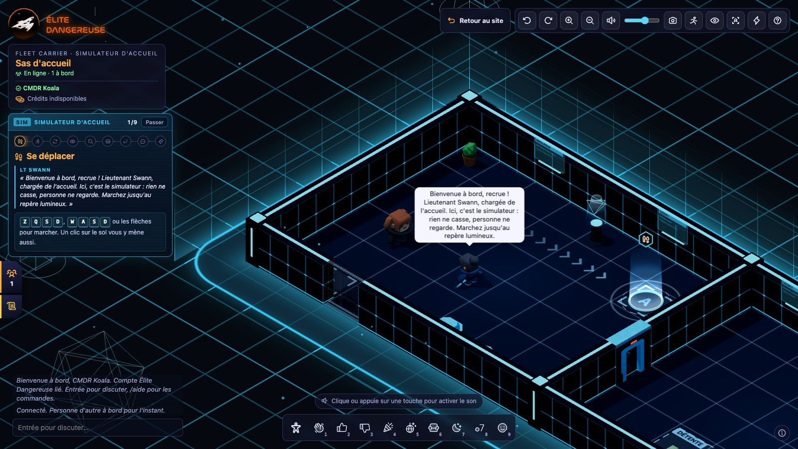<br><sub><b>Simulateur d'accueil</b> : on commence par une courte formation avec le lieutenant Swann.</sub></td>
    <td width="50%">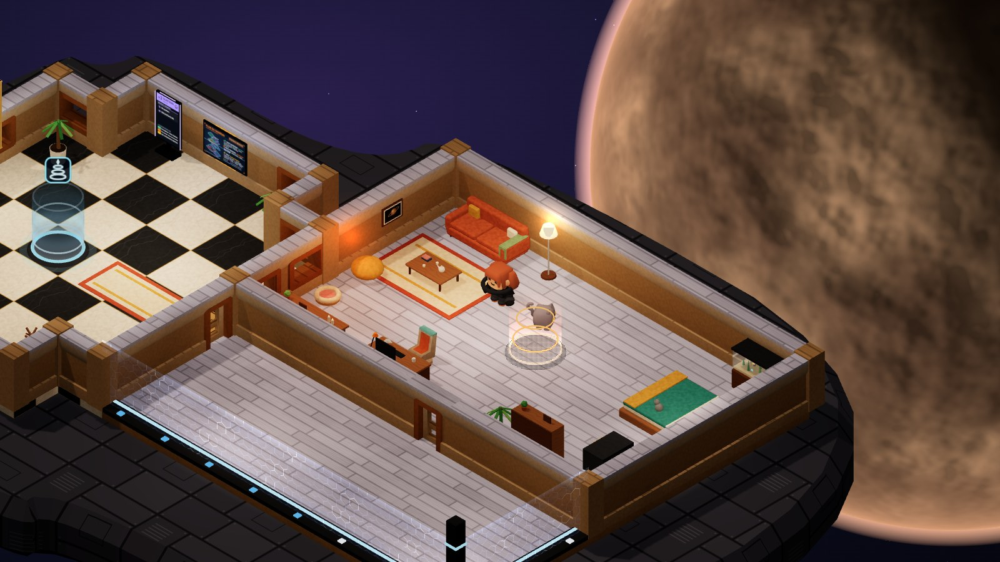<br><sub><b>Quartiers</b> : sa parcelle, à bâtir et à meubler (des centaines d'objets), où l'on invite qui l'on veut.</sub></td>
  </tr>
  <tr>
    <td>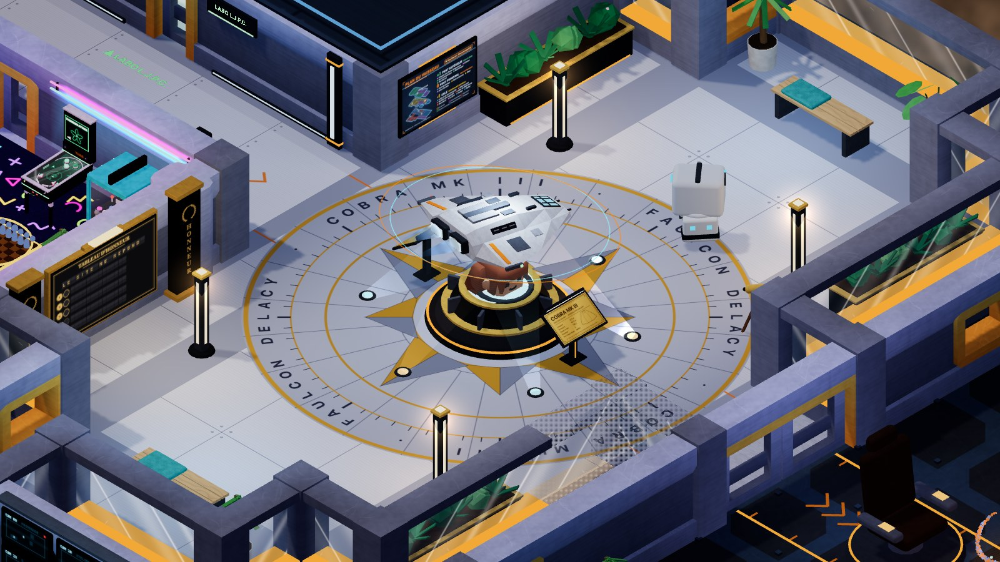<br><sub><b>La Promenade</b> : l'atrium du pont principal et sa maquette de Cobra Mk III.</sub></td>
    <td>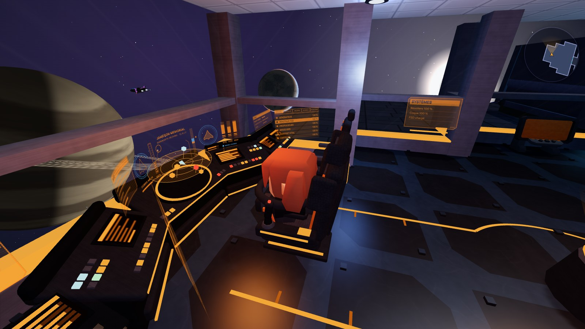<br><sub><b>Poste de pilotage</b> en vue subjective. On peut y lancer un saut FSD, vécu par tout le bord.</sub></td>
  </tr>
  <tr>
    <td>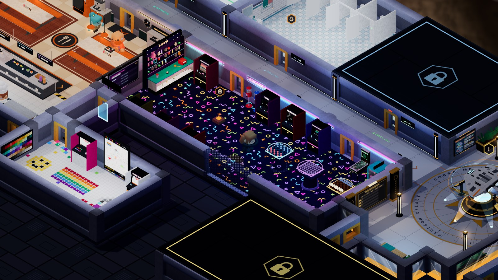<br><sub><b>Salon d'arcade</b> : Cargaison, Viper, Astéroïdes, Thargoid Invaders, Ruelle Fighter II, et un tableau des records.</sub></td>
    <td>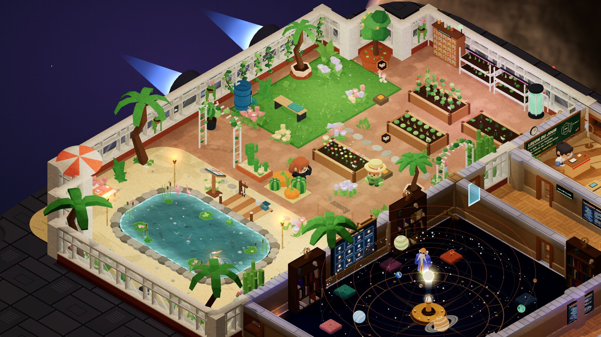<br><sub><b>Serre et jardin exotique</b> : potager, pêche dans l'étang, et le planétarium juste à côté.</sub></td>
  </tr>
  <tr>
    <td>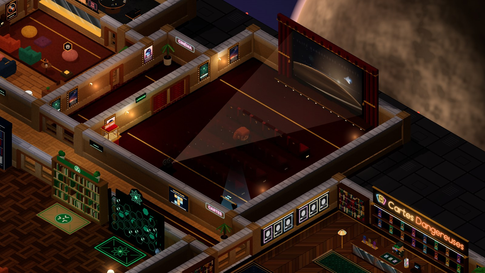<br><sub><b>Cinéma</b> : les vidéos se regardent ensemble, chat Twitch compris.</sub></td>
    <td>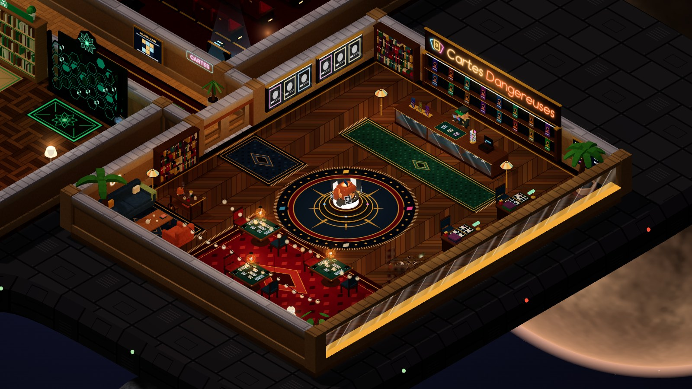<br><sub><b>Comptoir des Cartes Dangereuses</b> : on y achète et on y ouvre les boosters du jeu de cartes du site.</sub></td>
  </tr>
  <tr>
    <td>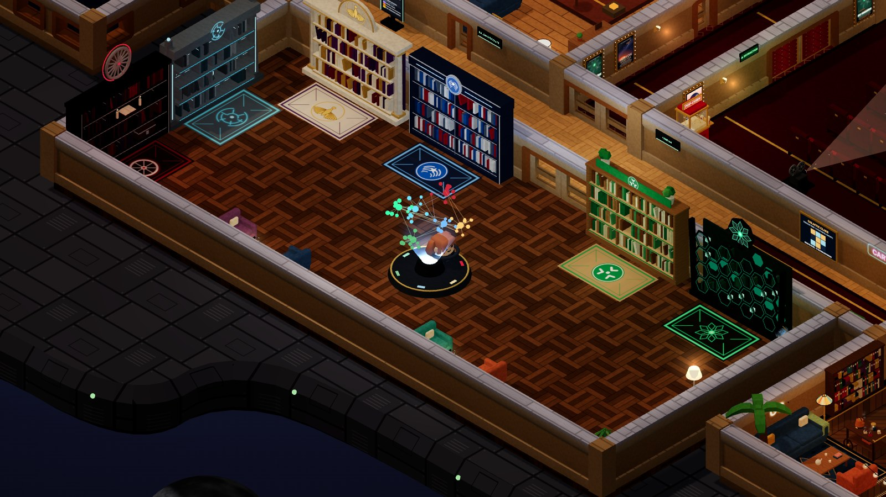<br><sub><b>Bibliothèque du lore</b> : six alcôves pour l'univers d'Elite.</sub></td>
    <td>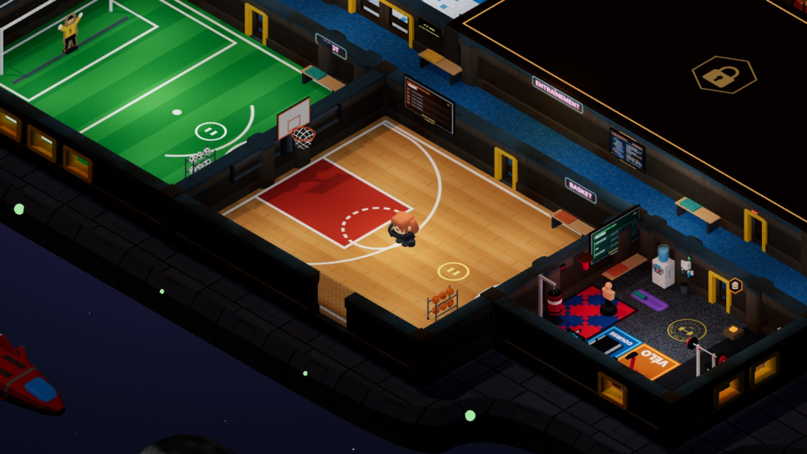<br><sub><b>Complexe d'entraînement</b> : salle de sport, basket et foot, ouverts par les quêtes.</sub></td>
  </tr>
</table>

## Les jeux

<table>
  <tr>
    <td width="50%">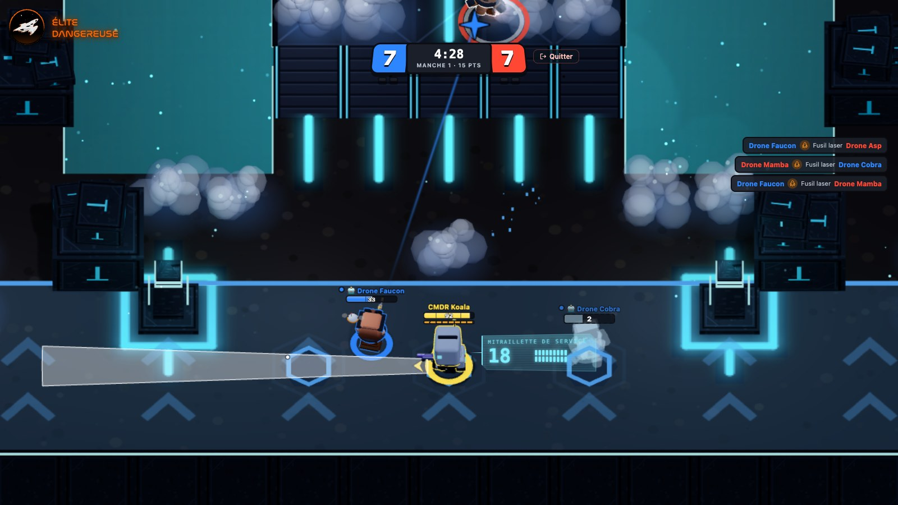<br><sub><b>CMDR Arena</b> : duels jusqu'à trois contre trois, dans l'esprit de Brawl Stars. Six personnages de l'équipage, des bots pour compléter, un classement.</sub></td>
    <td width="50%">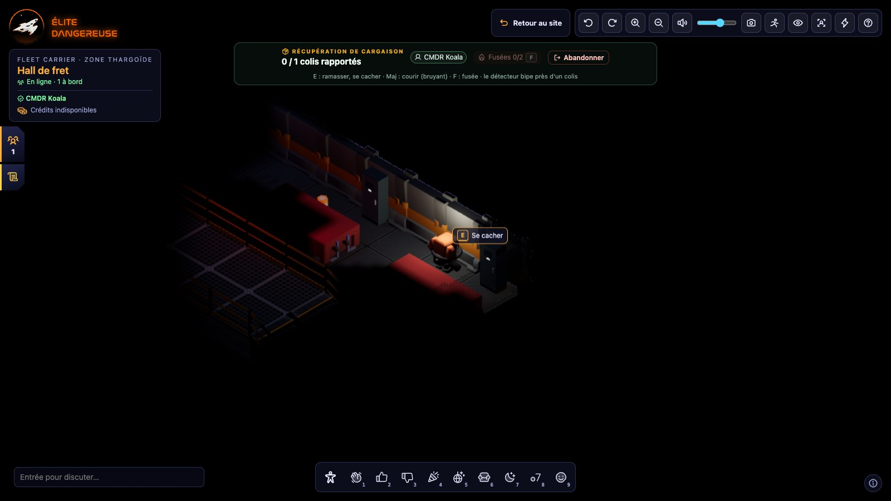<br><sub><b>Zone thargoïde</b> : un jeu d'horreur à quatre. On récupère des colis dans une baie plongée dans le noir, sans se faire repérer par ses occupants.</sub></td>
  </tr>
  <tr>
    <td colspan="2">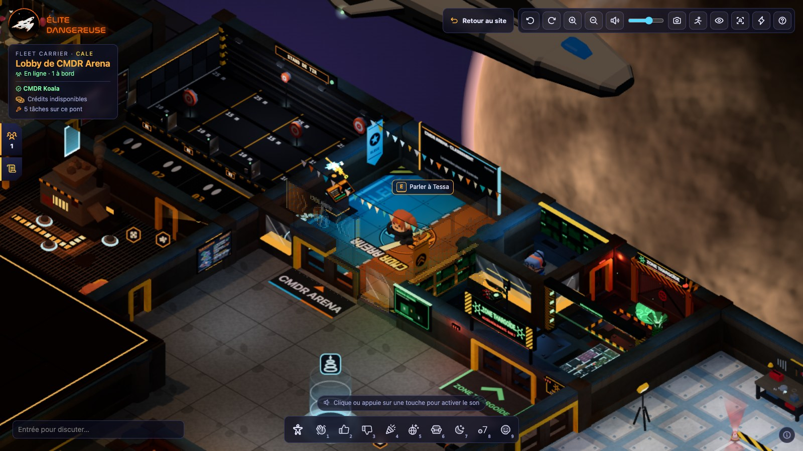<br><sub><b>La cale</b> : le lobby de CMDR Arena et Tessa l'arbitre, le stand de tir derrière, la zone thargoïde à côté.</sub></td>
  </tr>
</table>

Il y a aussi **MESS RUSH**, une cuisine en équipe façon Overcooked, une **vingtaine de quêtes** racontées en mini-cinématiques, des **tâches de bord** à régler, un **jukebox** que tout le pont entend, un **mode photo** jusqu'en 4K, et des secrets bien cachés dans la cale.

## Lancer en local

Il faut Node 20 ou plus.

```bash
npm install
npm run dev        # http://localhost:5173 : le jeu et le relais multijoueur
npm test           # les tests (relais, règles des jeux, économie…)
```

Ouvrir deux onglets suffit pour jouer à deux. En dev, `?cmdr=Nom` simule un CMDR connecté (`&patreon=1` en fait un soutien Patreon du site, qui entre au salon des mécènes et porte la combinaison Mécène), et `window.__game` expose de quoi piloter le jeu depuis la console.

Pour un serveur autonome, sur un seul port :

```bash
npm run build
npm start          # http://localhost:8080 (variable PORT pour changer)
```

Sur elitedangereuse.fr, le site sert lui-même `dist/`, et `npm start` ne fait tourner que le relais. Sans relais, le jeu se joue en solo.

Les comptes, les crédits, les quartiers, les quêtes et les scores sont gardés par le site. En local, le proxy de Vite les demande au Docker du site (`http://localhost:8080`, ou `ED_SITE_URL`). S'il ne répond pas, le jeu se replie sur le navigateur.

## Commandes

| | Clavier et souris | Manette |
|---|---|---|
| Se déplacer | `ZQSD` / `WASD` / flèches, ou clic au sol | Stick gauche |
| Courir | `Maj` | L3 |
| Interagir, s'asseoir | `E`, `Espace` ou clic | A / Croix |
| Discuter | `Entrée` | |
| Emotes | `1` à `8` (`8` : o7) | |
| Annuaire / quêtes | `Tab` / `J` | |
| Vue subjective / épaule | `V` / `C` | |
| Mode photo | `P` | |
| Aménager ses quartiers | `B` | |

Sur téléphone, en paysage : un joystick, des boutons d'action, et la caméra au doigt. L'aide en jeu (`H`) donne tout le reste.

## Sous le capot

- **Three.js + TypeScript + Vite** : une caméra orthographique au vrai angle isométrique filme des modèles 3D low-poly.
- **Relais socket.io** (`server/relay.js`) : il reçoit, vérifie et rediffuse positions, chat et emotes, et fait tourner les parties (arène, zone thargoïde, MESS RUSH).
- **Plans des ponts en ASCII** (`shared/ship-layouts.js`), une lettre par pièce, partagés entre le client et le relais.

| Dossier | Contenu |
|---|---|
| `src/` | le client : ponts, mobilier, caméra, interface, jeux |
| `server/` | le relais multijoueur et les tests |
| `shared/` | ce que le client et le relais partagent (plans, quêtes, règles) |
| `public/assets/` | modèles, sons, musiques |
| `scripts/` | imports d'assets et outils d'équilibrage |
| `docs/` | notes de conception |

Les tâches sont suivies sur le [tableau du projet](https://github.com/orgs/elitedangereuse/projects/6/views/2), et les bugs dans les [issues](https://github.com/elitedangereuse/Mini_ShipInteriors/issues).

## Crédits

- Modèles, sons et icônes de [Kenney](https://www.kenney.nl) (CC0) : Space Station Kit, Furniture Kit, Mini Characters, Cube Pets, Space Kit, et d'autres.
- Poissons de [Quaternius](https://quaternius.com) (CC0).
- Sprites de Ruelle Fighter II : *Fantasy Martial Characters 2* de [LuizMelo](https://luizmelo.itch.io/fantasy-martial-characters-2) (CC0).
- Musiques du jukebox : domaine public, CC0, et les albums de Ben Carter Jr (détail dans `public/assets/music/CREDITS.txt`).
- Icônes de l'interface : [Phosphor Icons](https://phosphoricons.com) (MIT).
- Visuels des réactions : [elitedangereuse.fr](https://elitedangereuse.fr), non libres.

Les licences d'origine sont copiées à côté des fichiers.

<p align="center"><sub>o7, CMDR.</sub></p>
