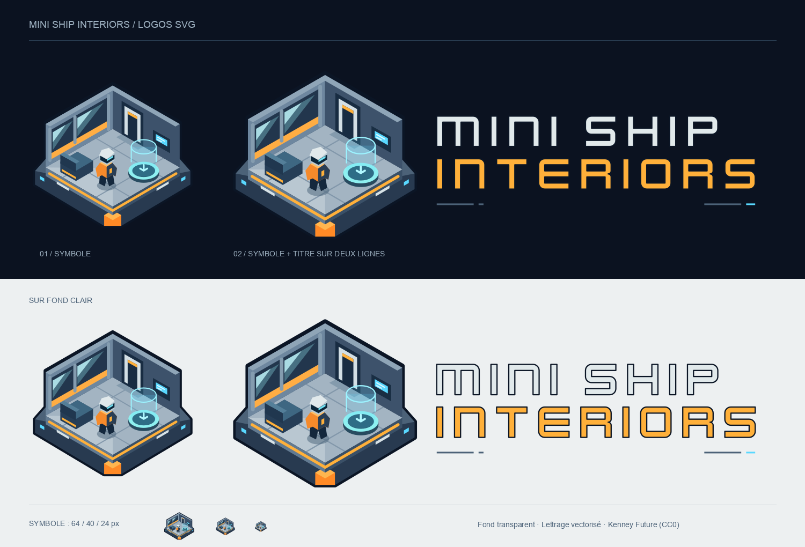
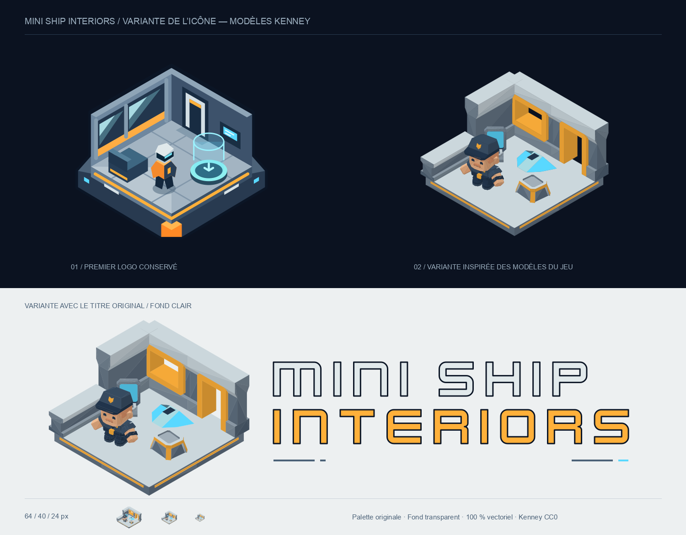

# Logo Mini Ship Interiors

- [Symbole seul](../public/logo-mini-shipinteriors.svg) : `viewBox="0 0 512 512"`.
- [Symbole et titre](../public/logo-mini-shipinteriors-title.svg) : `viewBox="0 0 1360 512"`, symbole à gauche, « MINI SHIP » puis « INTERIORS » à droite.

Le symbole reprend la vue isométrique et les volumes low-poly du jeu : un
intérieur ouvert, une verrière, une banquette, un petit CMDR et le téléporteur
holographique, posés sur une coque aux feux cyan. L'orange `#ffb03a`, le cyan
`#59d8ff` et les gris bleutés viennent de l'identité du jeu.

## Aperçu de la variante Kenney

Cette planche conserve l'essai réalisé à partir des modèles **Space Station
Kit** et **Mini Characters** de Kenney (CC0), présents dans `assets/3D assets/`.
Les SVG de cet essai ne sont plus livrés. La variante orange a également été
retirée ; le jeu utilise le premier logo et sa palette d'origine.

## Utilisation

Tous les SVG ont un fond transparent et sont autonomes : aucun bitmap,
script, lien externe ou chargement de police. Le titre utilise **Kenney Future**,
déjà présent dans `assets/Other/Fonts/` et fourni sous licence **CC0** ; ses
lettres sont converties en tracés. Le texte accessible reste dans `<title>`
et `<desc>`.

Conserver les proportions et une marge libre autour du dessin. Pour garder
les détails lisibles, privilégier au moins **64 px** de large pour le symbole
et **400 px** pour la version avec titre. La planche montre aussi le symbole
à 40 et 24 px pour apprécier la perte de détails.

Les fichiers sont servis depuis la racine du jeu, par exemple
`/logo-mini-shipinteriors-title.svg`, et copiés dans `dist/` par Vite au build.

Le logo avec titre remplace celui d'Élite Dangereuse dans le coin supérieur
gauche du HUD : 240 px de large, ou 200 px sous 720 px de largeur d'écran.
Sur les appareils tactiles en paysage, il reste masqué selon les règles
existantes du HUD. L'écran de chargement conserve le logo du site.
